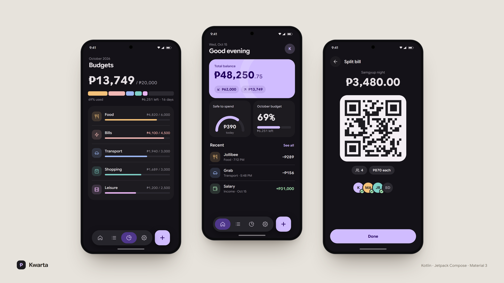

<div align="center">

# Kwarta

**Offline-first personal finance & budgeting for Android.**
Track income and expenses, plan monthly budgets, and split bills, with no account, no cloud and no ads.




</div>

## ✨ Highlights

| | |
|---|---|
| 💸 **Dashboard at a glance** | Animated balance hero card, daily safe-to-spend dial and recent transactions. |
| 📊 **Smart budgets** | Per-category monthly limits with a segmented spending bar and 75% / 90% alerts. |
| 🧾 **Receipt OCR** | Snap a receipt; on-device ML Kit fills in the merchant and total. |
| 🎙️ **Voice logging** | Say *"McDonalds 250 pesos"* and it's logged. Parsed fully offline. |
| 👥 **QR bill splitter** | Split a bill, show a QR, friends scan to record their share. |
| 🔄 **Nearby sync** | Merge recent transactions with a partner's phone over QR, deduplicated. |
| 📤 **Export reports** | Share your transactions as a CSV spreadsheet or PDF report. |
| ⚡ **Log from anywhere** | Home-screen widget, launcher shortcuts, Quick Settings tile and assist gesture. |
| 🎨 **Make it yours** | Light/dark, 5 palettes or Material You dynamic color. |

## 🚀 Features

<details>
<summary><b>Material 3 Expressive UI</b></summary>

- **Hero balance card** with a primary-to-secondary gradient; the balance counts up from zero on launch.
- **Floating pill toolbar** (`HorizontalFloatingToolbar`) that hides on scroll down and returns on scroll up.
- **Spring-animated FAB menu**: Add Income, Add Expense, Set Budget, Voice Log.
- **Container transform** into transaction details from both Dashboard and Transactions via `SharedTransitionLayout`.
- **Predictive back** (Android 14+) that morphs detail views back into their list items.

</details>

<details>
<summary><b>Quick entry shortcuts</b></summary>

- **Home-screen widget** (3×2): glassmorphic balance card with large Income / Expense buttons, refreshed on every insert.
- **Launcher shortcuts**: long-press the icon for Add Expense / Add Income.
- **Quick Settings tile**: "Quick Expense" opens the recorder from the notification shade.
- **Assist gesture**: set Kwarta as the default assistant app and long-press Home to log an expense.
- **Intent routing** in `MainActivity` handles all of the above on both cold and warm starts.

</details>

<details>
<summary><b>Budgets & categories</b></summary>

- Monthly limits per expense category.
- Segmented bar showing each category's share of spending, in its own color.
- Alerts: amber at 75%, red past 90% or overspent.
- Create, edit or archive categories, with type (Expense / Income), priority (Need / Want / Saving) and 8 accent colors.
- Archiving keeps historical transactions intact.

</details>

<details>
<summary><b>Transactions</b></summary>

- Title, merchant, notes and receipt image.
- Capture a receipt with the camera (`FileProvider` + `TakePicture`) or pick from the gallery; images are copied to internal storage.
- On-device receipt OCR (Google ML Kit) pre-fills empty Title and Amount fields.
- Export to **CSV** or **PDF** and share through the system sheet.

</details>

<details>
<summary><b>Offline voice logger</b></summary>

- Tap **🎙 Voice Log** and speak a phrase like *"Salary 50000"*.
- Regex-based heuristics extract the description, amount and type locally; no voice data leaves the device.

</details>

<details>
<summary><b>Group bill splitter & nearby sync</b></summary>

- **Bill splitter**: enter the total and headcount to get per-person shares as a QR code. Friends scan to record their share; tapping **Done** logs the host's share.
- **Nearby sync**: packs the latest 30 transactions and their categories into a QR (ZXing). The partner scans it with Google Code Scanner, and duplicates (same title, amount, type and time) are skipped.

</details>

<details>
<summary><b>Settings & data</b></summary>

- Theme: System, Light or Dark.
- Palettes: Purple, Blue, Green, Orange, Monochrome, or Material You (Android 12+).
- Toggle the safe-to-spend dial; the budget card expands to fill the row when it's off.
- Daily reminders and budget alert notifications.
- Balance reconciliation with a resettable manual offset.
- Double-confirmed factory reset in the Danger Zone.

</details>

## 🛠️ Tech Stack

| Layer | Choice |
|---|---|
| UI | [Jetpack Compose](https://developer.android.com/jetpack/compose), Material 3 Expressive (`material3:1.5.0-alpha21`) |
| Architecture | MVVM + Repository |
| DI | [Koin](https://insert-koin.io/) |
| Storage | [Room](https://developer.android.com/training/data-storage/room) (SQLite) |
| Async | Kotlin Coroutines, `StateFlow` / `SharedFlow` |
| Background | WorkManager (daily reminders) |
| On-device ML | ML Kit Text Recognition, Google Code Scanner, ZXing |

## 📂 Project Structure

```text
app/src/main/java/com/example/kwarta/
├── data/
│   ├── local/          # Room entities, DAOs, AppDatabase, migrations
│   └── repository/     # FinanceRepository + implementation
├── di/                 # Koin modules
├── notification/       # Channels, budget alerts, daily reminder worker
├── tile/               # Quick Settings tile (QuickExpenseTileService)
├── ui/
│   ├── components/     # Reusable widgets (e.g. ExpressiveBudgetRing)
│   ├── navigation/     # Destinations, NavHost, deep-link routing
│   ├── screens/        # Dashboard, Transactions, Budgets, Settings, Onboarding
│   └── theme/          # Color, Typography, Shape
├── utils/              # Voice & receipt parsers, export helper
├── widget/             # App widget provider + updater
├── KwartaApplication.kt
└── MainActivity.kt
```

## 🏗️ Build & Run

**Requirements:** JDK 17+ (Android Studio's bundled JBR works) and Android SDK 37. Runs on Android 11 (API 30) and up.

```bash
# Compile
./gradlew compileDebugKotlin

# Build a debug APK
./gradlew assembleDebug

# Install on a connected device or emulator
./gradlew installDebug
```

> On Windows, use `.\gradlew` and, if Gradle can't find a JDK, point it at Android Studio's:
> `.\gradlew assembleDebug "-Dorg.gradle.java.home=C:\Program Files\Android\Android Studio\jbr"`
